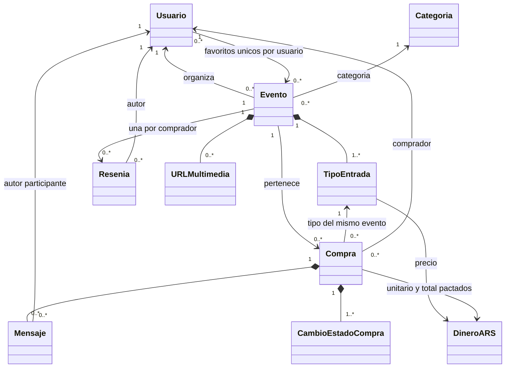
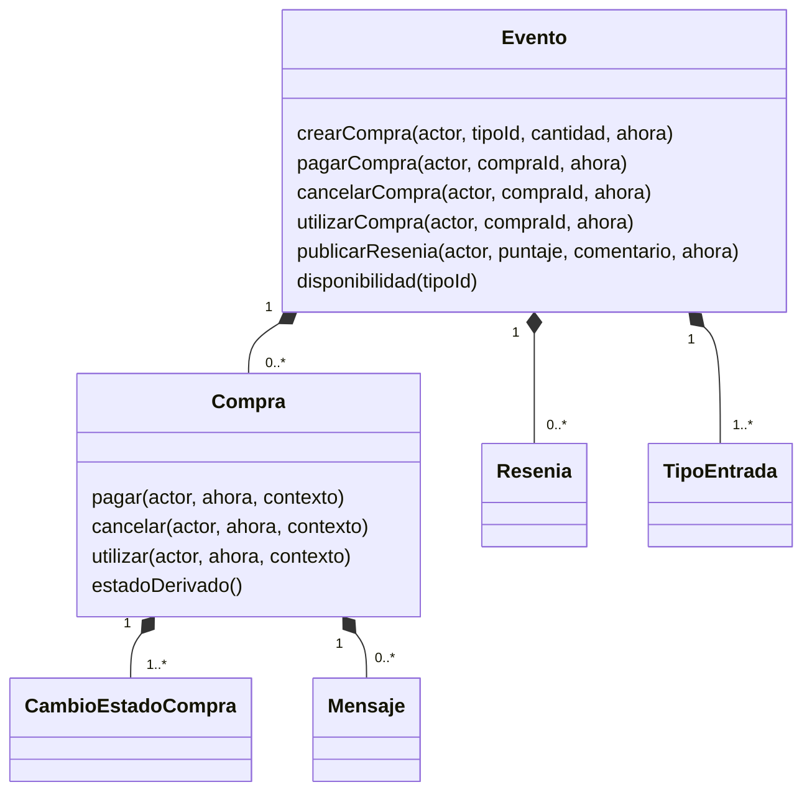
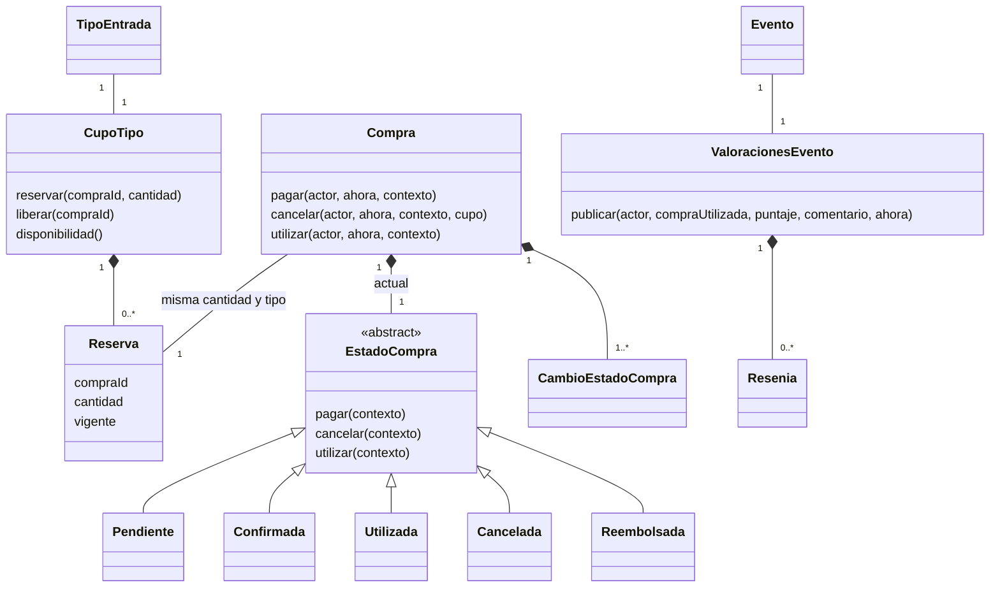
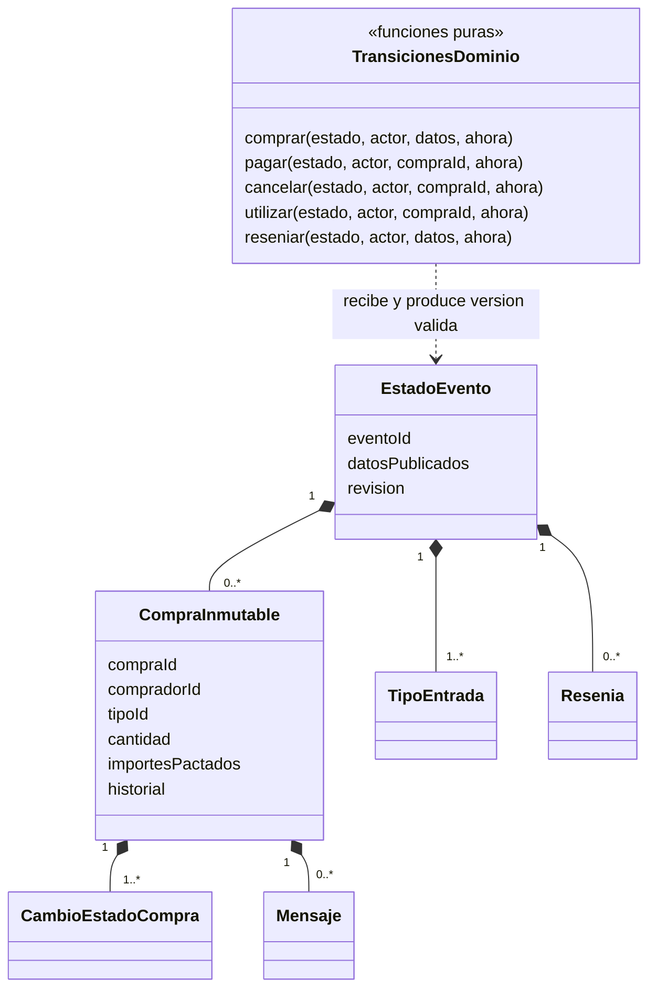

# Tres alternativas de dominio para AI Ticket It

**Estado: comparación conservada; opción A seleccionada por la usuaria el 22/11/2026.** Alcance: únicamente punto 3, capa de dominio. Entrega indicada: 23/11/2026.

Se recomienda **A: dominio enriquecido con Evento como raíz de consistencia**, posteriormente seleccionada para implementación. El detalle y estado actual de esa opción están en [design.md](design.md). B y C son alternativas realizables con el mismo comportamiento, no etapas que deban agregarse a A.

## 1. Base y prioridad de cualidades

Base normativa: [decisiones.md](decisiones.md) y las capacidades [eventos](specs/eventos/spec.md), [compras](specs/compras/spec.md), [mensajes](specs/mensajes/spec.md) y [resenas](specs/resenas/spec.md), aprobadas el 22/11/2026. Se consultaron antes el contexto breve y proposal.md; después el DOCX original, su diagrama tentativo y el PDF de teoría.

Referencia académica: `C:\Users\Malena\Desktop\Contexto_Tp_Individual\[DDS UTN] Clase Semana - 04 - Parte II.pdf`, páginas 4, 6–12, 15, 38, 41 y 50. La materia usa las cualidades como criterios para comparar alternativas: acoplamiento como dependencia/conocimiento entre componentes; cohesión como responsabilidades relacionadas; KISS/YAGNI contra complejidad innecesaria; robustez ante fallas sin dejar información inconsistente; flexibilidad mediante mantenibilidad y extensibilidad. La p. 50 vincula cohesión con facilidad de prueba. La prioridad siguiente es una decisión para este TP, no una clasificación universal atribuida al PDF.

| Prioridad | Cualidad | Razón y compromiso aceptable |
|---|---|---|
| Condición mínima, no negociable | Robustez y consistencia | Ninguna opción puede vender por encima del cupo, liberar dos veces, aceptar acceso ajeno o perder la historia del reembolso. Menos clases no compensa incumplir reglas. |
| 1 entre diseños correctos | Simplicidad y comprensión | Queda un día hasta la entrega; se debe realizar y defender el diseño. Evitar abstracciones para pagos reales, vencimientos o extensiones no pedidas. |
| 2 | Testabilidad | Tiempo controlado, importes exactos y efectos observables facilitan comprobar reglas y límites sin Express ni un teléfono. |
| 3 | Cohesión y bajo acoplamiento | Reglas cerca de sus datos; independencia de infraestructura. Se admite colaboración interna explícita para proteger cupo y reseñas. |
| 4 | Mantenibilidad | Poder localizar una regla y modificarla sin duplicarla importa más que reducir líneas. El historial y las fuentes únicas de verdad ayudan. |
| 5 | Flexibilidad y extensibilidad | Valiosas ante cambios reales; hoy no justifican una jerarquía o motor de reglas por cada posibilidad futura. |

El encapsulamiento es un medio transversal: colecciones no mutables desde fuera y comandos de negocio impiden saltarse invariantes. No se cuenta como beneficio separado para inflar la evaluación. SOLID, KISS y YAGNI son principios; no son patrones GoF.

## 2. Contrato común a las tres opciones

Las tres preservan todas las reglas documentadas en design.md §3–5, aunque cambian el responsable estructural. No se modifica el alcance por elegir una alternativa:

- Usuario y Evento tienen ID estable; Categoria es referencia con ID. TipoEntrada pertenece a exactamente un evento y su identidad es (eventoId, idLocal). Compra tiene ID, exactamente un comprador, un tipo y un evento coincidente. Cantidad entera positiva; compra ajena al organizador y antes del inicio.
- DineroARS es valor exacto en centavos; precio y total pactados inmutables. Inicio futuro al publicar, fin posterior; pagar/cancelar/comprar requieren ahora < inicio; utilizar requiere ahora ≥ inicio; reseñar, ahora ≥ fin y compra UTILIZADA. Se inyecta `ahora` como argumento, no un reloj global.
- PENDIENTE reserva; CONFIRMADA y UTILIZADA conservan ocupación. CANCELADA/REEMBOLSADA no ocupan. No hay vencimiento automático. Cancelación pagada registra ambos estados y reembolsa total sin una segunda liberación.
- Historial inmutable con acción, origen, destino, actor Usuario/Sistema, momento y secuencia; reembolso referencia su cancelación. Autorizar antes de reconocer una repetición. Detectar pago/cancelación/uso ya realizados en la historia, no solo en el estado actual.
- Mensaje pertenece a una compra, autor participante y texto no vacío; orden de envío con secuencia local y momento; lectura y envío privados en cualquier estado. Resenia tiene identidad (eventoId, compradorId), puntaje entero 1..5 y comentario no vacío; sin edición/borrado. Varias compras no habilitan varias reseñas.
- Favoritos es conjunto propio de eventoId; multimedia es una colección de URLMultimedia válidas. Sin carga de archivos ni restricciones nuevas sobre proveedores.
- Catálogo y reputación usan las funciones puras detalladas en design.md §4: normalización de texto, categoría, eventos futuros incluso agotados, precio mínimo incluso agotado, orden e inversión estable, promedio de todas las reseñas sin redondear para ordenar, ausencia de puntaje al final, reseñas previas identificadas por evento. Días restantes por calendario argentino. El detalle de eventos pasados sigue accesible desde compras/reseñas con disponibilidad y URLs; el filtro futuro se aplica solo al catálogo. Para el detalle histórico se explicita en design.md una interpretación revisable de “anteriores”: otros eventos finalizados al momento de consulta, sin alterar el promedio global.

### Relaciones comunes

Este fragmento es parte de los tres diagramas. Las siguientes vistas específicas completan propiedad y consistencia. Los diagramas Mermaid son texto editable incluido en el proyecto y no dependen de una cuenta ni un enlace externo.

Cada entidad conserva su identidad durante su vida. Mensaje y CambioEstadoCompra son registros inmutables con identidad local (compraId, secuencia). No se introducen clases Comprador/Organizador por herencia: son capacidades y relaciones de Usuario.

## 3. Alternativa A: objetos enriquecidos y consistencia por Evento

### Idea y distribución

Evento posee sus compras y reseñas; Compra contiene comportamiento del ciclo de vida. Estado actual se deriva del último CambioEstadoCompra. Disponibilidad se deriva de las cantidades de compras que ocupan cupo. Se elimina un contador de stock adicional y su sincronización con la compra.

El diagrama completo con atributos está en design.md §2. Evento controla incorporación/pertenencia, cálculo de disponibilidad y unicidad de reseña; Compra autoriza participantes y protege historia, transiciones y mensajes; Usuario protege favoritos; los valores validan importes y URL. Las reglas puras comunes evitan una clase que mezcle catálogo con cambios de compras.

Las mutaciones de Compra se realizan únicamente en colaboración con su Evento, sin exponer referencias mutables. Validar y aplicar es una única operación conceptual. Cancelar pagada anexa dos cambios juntos; el cálculo deja de contar esa compra una sola vez. Las repeticiones no anexan registros.

### Patrones, cualidades y costo

Usa Domain Model y Aggregate como patrones de dominio; Value Object para DineroARS/URLMultimedia. No necesita un patrón GoF. Un enum de estados con operaciones explícitas resulta suficiente; no es el patrón State. Encapsulamiento y separación de responsabilidades son principios.

Favorece simplicidad, robustez y facilidad de explicación: una sola autoridad para el cupo, sin reconciliar reserva con compra. Las reglas temporales y monetarias son fáciles de probar aisladamente. Compromete cohesión de Evento si crece: reúne ventas y reseñas y sus operaciones se serializan aunque afecten tipos distintos. Compra mantiene las reglas locales para que Evento no absorba todo el comportamiento.

**Complejidad inicial baja-media; prueba baja-media.** Un solo conjunto consistente por evento, sin pruebas de sincronización entre dos estados de reserva. Se necesitan pruebas futuras de colaboración y de la garantía externa de concurrencia, además de reglas unitarias. Calcular disponibilidad cuesta recorrer compras del tipo; sin índices adicionales, puede recorrer las del evento. Es razonable para memoria y demo, no una promesa de alto volumen.

**Preferible:** alcance pequeño, pocos datos y estados estables, defensa centrada en reglas claras. **Límite:** un evento masivo o conversaciones muy activas harían inconveniente su tamaño y contención.

## 4. Alternativa B: Compra con State y reservas explícitas por tipo

### Idea y distribución

Se separan la vida de Compra y la administración de cupo. **CupoTipo** es una raíz de dominio por TipoEntrada, con Reservas identificadas por compraId. Compra es otra raíz, con un objeto EstadoCompra que implementa su comportamiento. **ValoracionesEvento** es raíz por evento para garantizar reseña única sin recorrer una colección de compras dentro de Evento.

CupoTipo se identifica por (eventoId, tipoId) y toma su capacidad de la oferta inmutable, sin otro cupo editable. Reserva es entidad interna con identidad compraId; su cantidad/tipo son inmutables y coinciden con Compra. EstadoCompra y sus cinco variantes son objetos de comportamiento sin identidad de negocio. ValoracionesEvento se identifica por eventoId y guarda reseñas por compradorId. Mensajes permanecen dentro de Compra; Usuario, Categoria, DineroARS y URL conservan la base común.

La creación conceptual `Compra.crear(actor, evento, tipo, cantidad, cupo, ahora)` valida las reglas y colabora con CupoTipo.reservar; la pareja compra/reserva se publica junta o no se publica. No existe una reserva huérfana válida. Pagar no toca CupoTipo. Cancelar colabora con el cupo asociado: liberar compraId marca la reserva no vigente solo si estaba vigente; una segunda liberación no incrementa disponibilidad. Una reserva UTILIZADA sigue vigente como ocupación, aunque el nombre ya no denote espera de pago.

State decide las transiciones nuevas; Compra comprueba actor e historial para repetición antes de delegar. Así una variante Reembolsada reconoce un pago anterior a través de Compra, sin duplicar historia en cada estado. El estado actual es almacenado: al cambiarlo se anexa el historial en la misma operación y debe coincidir con su último destino. Cancelar desde Confirmada produce Cancelada y Reembolsada juntos y una sola liberación; Cancelada desde Pendiente no habilita reembolso.

ValoracionesEvento recibe la compra utilizada real y el evento, verifica sus identidades, autor, utilización y fin; su mapa impide otra reseña del mismo comprador. El exterior debe aportar objetos auténticos y vigentes, no una afirmación booleana de “asistió”. Las funciones comunes derivan reputación, precio y consultas sin datos duplicados.

### Consistencia, patrones y costo

Invariantes adicionales: una reserva por compra; reserva vigente si y solo si la compra está PENDIENTE/CONFIRMADA/UTILIZADA; cantidades iguales; estado actual coincide con último cambio. **La separación no elimina atomicidad:** crear exige validar cupo y publicar compra/reserva como una unidad; cancelar exige compra, reserva e historial juntos. Pago y cancelación competidores sobre una misma compra también deben serializarse. ValoracionesEvento serializa comprobación e inserción; los objetos de elegibilidad deben ser vigentes. No se diseña cómo proveer estas garantías.

Patrones de dominio: agregados más pequeños y Value Object. **State sí es GoF**: localiza comportamiento por fase y permite cambiarlo sin agrandar condicionales de Compra. Mejora cohesión de cada fase y extensibilidad, pero agrega cinco variantes, un contrato común y pruebas de delegación. Separar CupoTipo mejora cohesión de capacidad y permitiría menos contención entre tipos; a cambio aumenta el acoplamiento de cada operación entre raíces.

**Complejidad inicial y de prueba alta respecto de A.** Requiere verificar estados, interacción con reservas y fallos entre efectos de varias raíces; es realizable, pero fácil de dejar incompleto para mañana. Reservas indexadas por compra permiten liberación localizada; calcular disponibilidad puede seguir sumando reservas vigentes, sin contador adicional.

**Preferible:** crecimiento real de reglas distintas por estado y administración de reservas como concepto independiente. **Límite actual:** cinco estados con pocas transiciones, pago simulado y ausencia de vencimientos no aprovechan suficiente State. No se agrega una Strategy de pagos reales para justificarlo.

## 5. Alternativa C: modelo inmutable con transiciones puras

### Idea y distribución

Se representan entidades mediante valores inmutables con identidad estable; funciones de dominio reciben un estado válido y producen una nueva versión válida o un rechazo. No hay entidades mutables con métodos de cambio. **EstadoEvento** contiene la información de Evento, tipos, compras y reseñas; cada Compra contiene sus registros inmutables. Usuario tiene su propio estado inmutable con favoritos.

`TransicionesDominio` agrupa conceptualmente funciones, **no es una clase ni un servicio de aplicación**. Las identidades y multiplicidades de la base común siguen vigentes; CompraInmutable es la representación de Compra, no otra entidad añadida. EstadoEvento reemplaza la representación mutable de Evento y preserva su ID entre versiones. `revision` es un valor opaco para distinguir versiones, no un estado comercial ni el número de cambios del historial.

`comprar(estado, actor, datos, ahora)` comprueba capacidad calculada y produce una versión con Compra PENDIENTE. `pagar/cancelar/utilizar` validan actor, repetición histórica, estado y tiempo, y devuelven una versión nueva con todo el historial necesario. Estado comercial se deriva del último registro; disponibilidad, de compras ocupantes. `reseniar` comprueba la compra utilizada y unicidad dentro de EstadoEvento. `enviarMensaje` valida participantes y texto y devuelve la conversación ampliada en otra versión. `guardarFavorito/quitarFavorito` operan sobre la versión de Usuario correspondiente.

Los constructores de valores y funciones de transición son la única vía admitida para obtener versiones válidas. Lecturas profundamente inmutables, no copias superficiales que compartan listas mutables. El resultado conceptual distingue realizado, operación ya realizada y rechazo; solo el primero produce cambios. No se diseña un DTO ni un contrato HTTP. Las funciones de consulta comunes reciben los valores inmutables.

### Consistencia, patrones y costo

La transición pura **no publica** por sí sola el resultado. El exterior debe garantizar aplicación indivisible de una nueva versión basada en la versión vigente, sin perder cambios de otra operación. Si la versión base ya no es vigente, la operación debe volver a evaluarse sobre la actual: nunca reemplazarla a ciegas. Esto vale para compras, mensajes y reseñas; Usuario tiene el mismo contrato para favoritos. Dos resultados válidos calculados desde la misma última entrada no pueden aceptarse ambos.

No usa GoF. Usa valores inmutables y un límite de consistencia por evento; núcleo funcional es un estilo arquitectónico del dominio, no un patrón GoF. Las funciones tienen comportamiento de negocio; el modelo no delega las reglas a capas externas. No es event sourcing, CQRS ni exige guardar todas las versiones históricas.

Favorece testabilidad y razonamiento sobre fallos: misma entrada y momento generan los mismos efectos comerciales; el estado original no se modifica. Facilita comprobar invariantes comparando antes/después. Compromete familiaridad de una defensa orientada a objetos, localización de comportamiento junto al dato y costo de copiar estructuras. Si se permite construir libremente estados inválidos, pierde su principal garantía: la frontera de construcción es esencial.

**Complejidad inicial media; prueba de reglas baja, de publicación concurrente media.** Se necesitan pruebas futuras de pureza, no mutación profunda, repetición y rechazo de versiones obsoletas, además de reglas comunes. IDs y momentos se reciben para mantener determinismo; no se generan dentro de las funciones puras.

**Preferible:** equipo cómodo con programación funcional, interés en comparación de estados y alto aislamiento de reglas. **Límite:** copiar colecciones grandes y mantener correctamente la frontera inmutable puede costar más que objetos pequeños en este TP.

## 6. Patrones: beneficio frente al costo

| Recurso y clasificación | Problema / mejora concreta | Costo | Alternativa simple y juicio actual |
|---|---|---|---|
| Domain Model, dominio (A/B) | Encapsular validaciones y transiciones junto a sus datos; cohesión y robustez | Métodos y colaboración que deben respetar límites | Funciones puras de C también son válidas. A es la opción OO más directa para este caso. |
| Aggregate, dominio (A/B; frontera equivalente en C) | Delimitar invariantes que deben verse juntas | A/C cargan una unidad mayor; B exige coordinación entre raíces | Objetos sueltos sin límite explícito ocultan el problema. El límite sí se justifica; no reemplaza atomicidad externa. |
| Value Object, dominio (todas) | Precisión monetaria y validez de URL, sin identidad accidental | Dos tipos conceptuales y sus validaciones | Enteros/cadenas validados en cada uso son más simples al inicio pero duplican reglas. Dinero se justifica claramente; URL puede ser un valor validado liviano. |
| State, GoF (B) | Separar comportamiento de cada fase y facilitar extensiones de fases | Cinco variantes, delegación y más combinaciones de prueba | Enum + comandos explícitos (A) o transición pura (C). No compensa hoy; defendible si el ciclo crece. |
| Strategy/Policy, evaluado y no adoptado | Reglas intercambiables de pagos, cancelación o precios | Abstracción y selección sin variación requerida | Las reglas son únicas y aprobadas. Funciones/operaciones concretas bastan. Ordenar por criterios no exige una jerarquía Strategy. |
| Inmutabilidad y núcleo funcional, estilo/principio (C) | Eliminar mutaciones parciales dentro de una evaluación; testabilidad | Construcción cerrada, copias y publicación de versiones | A valida antes de mutar. C puede compensar con experiencia funcional; no por etiqueta. |

El historial es un registro de dominio, no Observer ni Command. No se introducen herencia de usuarios, interfaces artificiales, eventos asíncronos ni servicios para exhibir patrones.

## 7. Los mismos seis recorridos

En todos se reciben actor resuelto, objetos válidos y momento controlado. El resultado ante infracción es rechazo sin cambios, salvo las repeticiones expresamente admitidas. La última columna es una obligación externa, sin diseñar quién la implementa.

| Recorrido | A: agregado enriquecido | B: reservas + State | C: versiones inmutables | Garantía externa |
|---|---|---|---|---|
| Dos compradores por la última entrada | Evento calcula 1, incorpora una Compra; la segunda evaluación calcula 0 y rechaza | CupoTipo acepta una Reserva; la segunda no tiene cupo. Compra y reserva aceptadas juntas | Ambos pueden calcular desde disponibilidad 1, pero solo una versión puede publicarse; reevaluar la otra sobre 0 da rechazo | A: evaluación/cambio serializados por evento. B: reserva y compra indivisibles, exclusión por cupo. C: nunca publicar resultados basados en una versión ya superada. |
| Pagar pendiente | Compra autoriza comprador, comprueba historial y ahora < inicio; anexa CONFIRMADA; suma de ocupación igual | Compra delega en Pendiente; cambia a Confirmada y anexa historial; no toca reserva | pagar devuelve versión con cambio a CONFIRMADA; disponibilidad derivada igual | Estado/historial juntos y lectura vigente de la compra; serializar con cancelación. |
| Cancelar pagada y reembolsar | Compra anexa CANCELADA y REEMBOLSADA, esta última por Sistema; sale una vez de la suma | Confirmada colabora con CupoTipo.liberar(compraId); registro de ambos estados y reserva no vigente juntos | cancelar produce una versión con ambos cambios; no hay versión pública intermedia | Una unidad para ambos cambios; B incluye también reserva. Fallo conserva estado anterior. |
| Repetir acción completada | Compra encuentra acción en historia después de autorizar y devuelve “operación ya realizada” | Compra revisa historia antes de State; no repite liberar | Transición devuelve misma versión y resultado “operación ya realizada” | Evitar que dos evaluaciones simultáneas ejecuten la primera acción dos veces. Repetir pago tras reembolso sigue siendo repetición; actor ajeno se rechaza. |
| Usar todas las entradas | Organizador y ahora ≥ inicio; Compra pasa completa de CONFIRMADA a UTILIZADA | Confirmada decide transición a Utilizada; reserva sigue ocupando cantidad completa | utilizar reemplaza compra en nueva versión; no divide entradas | Cambio/historial indivisibles, sin uso parcial; reintento sin nuevo registro. |
| Reseñar después del fin | Evento verifica al menos una compra UTILIZADA del actor y ausencia de su clave; incorpora Resenia | ValoracionesEvento verifica evidencia auténtica de Compra/Evento y clave comprador; incorpora | reseniar comprueba elegibilidad y clave en EstadoEvento; devuelve nueva versión | Verificar e insertar sin carrera por (evento, comprador). C exige versión vigente; B exige contexto válido. ahora = fin ya habilita. |

Para los tres diseños, mensajes permanecen habilitados después de cancelar; un segundo favorito no duplica; una segunda reseña se rechaza aunque otra compra sea utilizada. La creación de compras no se vuelve idempotente por coincidencia de tipo/cantidad: el requisito de repetición se aplica a pago, cancelación y uso. No se elimina una compra legítima por intentar deduplicarla sin una regla aprobada.

## 8. Cambios respecto del diagrama tentativo

Fuente: imagen de “Diagrama Tentativo” del DOCX `DDS UTN Trabajo Práctico Individual de Desarrollo con IA - 2C 2026 - Público`, carpeta Contexto_Tp_Individual. Se inspeccionaron sus atributos y relaciones, no solo la síntesis textual.

| Tentativo | Cambio propuesto y motivo |
|---|---|
| Sin IDs explícitos | IDs estables de entidades y claves locales; evita usar nombres y permite unicidad de reseña/favorito. |
| Evento.fecha | inicio y fin; necesario para distinguir compras/cancelación, utilización y reseñas aprobadas. |
| Compra.actualizarEstado(EstadoCompra) | Comandos de negocio pagar, cancelar y utilizar, o funciones equivalentes; el solicitante no elige un estado arbitrario. |
| precio/total Double; puntuacion Double | DineroARS exacto, total pactado; puntaje entero 1..5. Evita errores decimales e infracciones de rango/escala. |
| Compra.estado y CambioEstadoCompra.estado | A/C derivan estado de historial; B conserva objeto State con actualización indivisible del historial. Origen/destino/acción hacen inequívocos cambios y repeticiones. |
| CambioEstadoCompra.quien: Usuario | Actor Usuario o Sistema, secuencia y causa. Un reembolso automático no se atribuye falsamente a un usuario. |
| TipoEntrada.cupo / hayCupoPara | Capacidad total explícita y disponibilidad protegida. A/C derivan de compras; B de reservas. Un booleano consultado fuera de una operación indivisible no previene sobreventa. |
| Resenia asociada a comprador/evento | Se conserva y se precisa clave única por pareja; asistencia se demuestra por alguna compra utilizada, sin una reseña por compra. |
| Evento.tuPrecioEstaEntre | No es requerido por búsqueda/orden aprobados: se reemplaza por precioRepresentativo mínimo y criterios de consulta. No se agrega filtro por rango de precio. |
| favoritos: Evento[] y multimedia: String[] | Conjunto de IDs propio del usuario y valores URL válidos; mismas relaciones, invariantes explícitas. |
| Relaciones sin todas las cardinalidades | Evento tiene 1..* tipos; cada compra un único tipo del mismo evento; historial 1..*; mensajes/reseñas 0..*; autor y organizador explícitos. |

A concentra pertenencia de compras/reseñas en Evento; B agrega CupoTipo, Reserva, ValoracionesEvento y State; C cambia la representación y distribución del comportamiento a valores y funciones. Son cambios de consistencia y colaboración, no renombramientos del mismo modelo.

## 9. Matriz comparativa y recomendación

Evaluación relativa al TP: alta/media describen adecuación, no una medición empírica. Ninguna puntuación permite incumplir comportamiento.

| Cualidad | A | B | C |
|---|---|---|---|
| Simplicidad | **Alta:** pocas piezas, sumas e historial | Media-baja: reserva, estado y compra coordinados | Media: pocas reglas, disciplina funcional adicional |
| Cohesión | Alta en Compra/valores; media en Evento por tamaño | **Alta por objeto:** cupo, fase y valoración separados | Alta por función; datos/comportamiento separados |
| Bajo acoplamiento | Alto hacia fuera; colaboración interna acotada a Evento/Compra | Alto hacia infraestructura; menor entre raíces de venta | **Alto:** funciones sobre entradas explícitas; acoplamiento a forma del estado |
| Robustez/consistencia | Alta bajo atomicidad; sin stock/estado duplicado | Alta bajo atomicidad multirraíz; más invariantes cruzadas | Alta bajo publicación de versión vigente; sin mutación parcial |
| Testabilidad | **Alta:** objetos pequeños y ahora explícito | Media-alta: más colaboraciones y combinaciones | **Muy alta para reglas:** entrada/salida; publicación requiere verificación aparte |
| Mantenibilidad actual | **Alta:** cambios localizados; vigilar crecimiento de Evento | Media: reglas locales claras, efectos repartidos | Alta con experiencia funcional; media sin ella |
| Flexibilidad/extensibilidad | Media: cambios grandes pueden pedir dividir agregado | **Alta para ciclo/reservas:** State y límites independientes | Alta para añadir transformaciones; estructuras grandes pueden propagarse |
| Costo inicial / prueba | **Bajo-medio / bajo-medio** | Alto / alto | Medio / bajo en reglas, medio en concurrencia |
| Riesgo principal | Raíz grande y cálculo lineal | Desincronizar reserva, compra e historial | Publicar una versión obsoleta o mutar listas compartidas |

**Recomiendo A para el 23/11/2026.** Ofrece invariantes defendibles sin convertir el TP en un mecanismo de reservas o un ejercicio de polimorfismo de estados. Evita dos fuentes de verdad para cupo y estado, conserva las reglas en objetos de dominio y admite pruebas con tiempo controlado. El precio es recorrer compras y aceptar consistencia por evento; para memoria y el tamaño esperado de una demo resulta razonable. Ese tamaño es una expectativa de uso, no un límite comercial agregado a la especificación.

B es preferible si reservas y ciclo de vida adquieren variaciones concretas; hoy su costo inicial y de pruebas supera el beneficio. C es defendible si se prioriza un estilo funcional y se domina la inmutabilidad profunda; no mejora suficientemente el plazo y la explicación OO como para desplazar A por defecto. No se recomienda combinar las tres.

## 10. Comprobación y límites de la propuesta

Se contrastaron los tres modelos con E1–E7, C1–C14, M1–M4 y R1–R4: responsables comunes en §2; diferencias e invariantes en §3–5; seis recorridos en §7; trazabilidad detallada de A en design.md §7. En ningún diseño se introducen cobros reales, vencimiento, uso parcial, QR, edición/borrado ni otro comportamiento no aprobado.

La revisión es conceptual/documental, no ejecución de pruebas ni validación oficial de OpenSpec. Cada alternativa exige atomicidad externa; los diagramas no demuestran concurrencia por sí mismos. No se definen servicios de aplicación, repositorios, endpoints, DTOs, persistencia ni frontend. Las firmas expresan colaboración de dominio, no código ejecutable.

La usuaria seleccionó A y autorizó implementarla sin correr pruebas. Los mecanismos externos posteriores solo podrán elegirse respetando estos contratos; no forman parte de la implementación de dominio.
