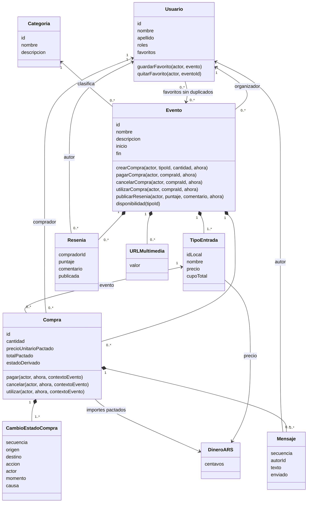
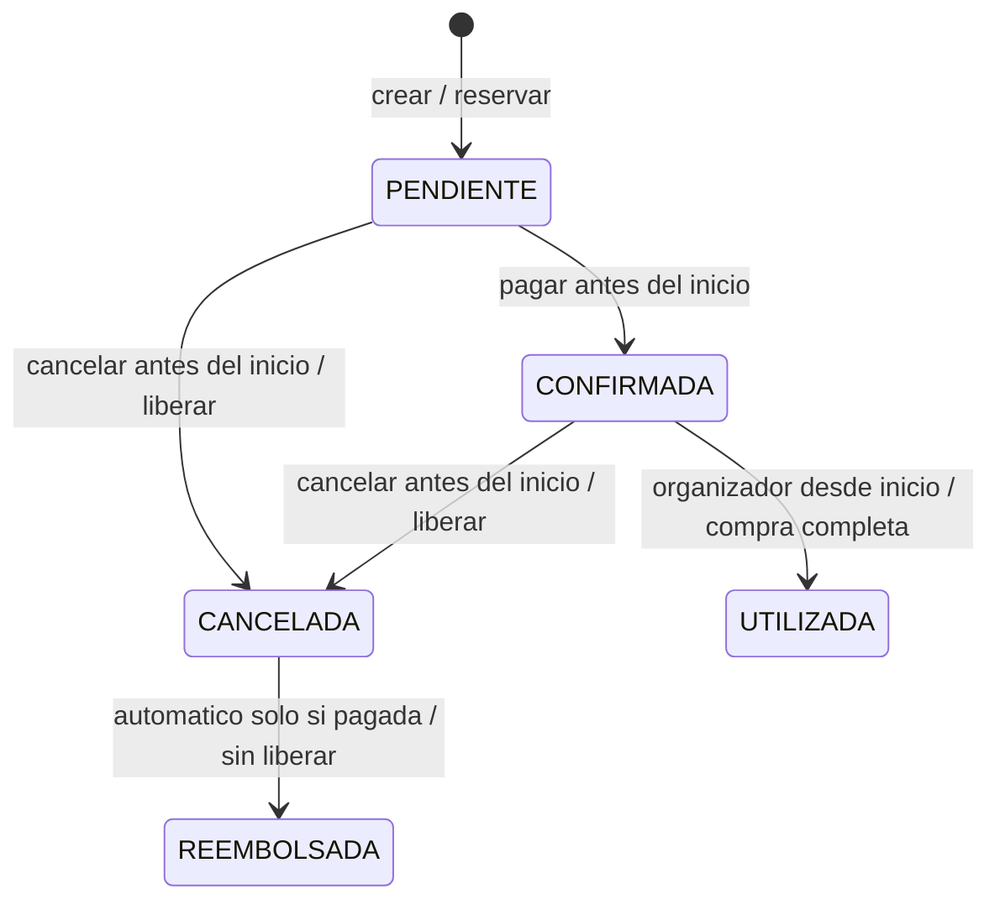

# Diseño de dominio de AI Ticket It

**Estado: Opción A seleccionada por la usuaria el 22/11/2026; implementación de dominio escrita, sin pruebas ejecutadas por instrucción expresa.**

Fecha: 22/11/2026. Punto 3 del TP Individual. Alternativa seleccionada: **A, dominio enriquecido con Evento como raíz de consistencia**. La comparación y sus fundamentos están en [alternativas-dominio.md](alternativas-dominio.md). La usuaria autorizó posteriormente su implementación, limitada a dominio.

## 1. Alcance y fuentes

Solo dominio: identidad, reglas, comportamiento, relaciones y contratos conceptuales. Node/Express, React Native, memoria y ejecución local son restricciones del proyecto; ninguna es una dependencia de este modelo. No se definen capas externas ni un plan de implementación.

Fuentes leídas, en el orden solicitado: CONTEXTO_BREVE.txt; [proposal.md](proposal.md); las 13 decisiones aprobadas de [decisiones.md](decisiones.md); las cuatro especificaciones; enunciado original y su imagen de diagrama tentativo; PDF de teoría, selectivamente. El pedido actual autoriza el diseño y supera las advertencias históricas de “todavía no diseñar”; no altera las decisiones de comportamiento.

No se detectaron contradicciones de comportamiento pendientes entre las especificaciones. La tensión del enunciado entre entrada utilizada y evento finalizado ya está resuelta por la decisión 3: ambas condiciones son necesarias. En R1/R4, “tras finalizar” incluye el instante exacto de fin. El plazo 23/11/2026 proviene de la usuaria; no del DOCX.

## 2. Estructura, identidad y responsabilidades

Un agregado es un conjunto de objetos cuyo cambio se valida y hace visible como una unidad. Aquí **Evento** controla la incorporación de compras y reseñas y el acceso a operaciones sobre sus compras. **Compra** conserva las reglas de su ciclo de vida. No se introduce un objeto global que reúna todos los eventos.

Las composiciones expresan pertenencia y control, no tablas ni decisiones de almacenamiento. No obligan a guardar referencias bidireccionales. Las firmas del dibujo son conceptuales; el contrato completo está debajo.

| Elemento | Identidad y datos propios | Responsabilidad |
|---|---|---|
| Usuario, entidad | ID estable; nombre, apellido y capacidades de comprador/organizador de la demo | Comprobar capacidad pertinente y propiedad de favoritos. Roles sin subclases; la propiedad concreta también debe comprobarse. No registra sesiones. |
| Evento, raíz y entidad | ID estable; organizador, categoría, nombre, descripción, inicio, fin, tipos, URLs, compras y reseñas | Validar creación completa; pertenencia de tipos/compras; cupo; unicidad de reseña; controlar acceso a operaciones del agregado. Datos publicados inmutables en este alcance. |
| TipoEntrada, entidad interna | Clave (eventoId, idLocal); nombre, precio, cupoTotal | Definición válida de la oferta. Nombre no identifica un tipo. Cupo es capacidad original, nunca disponibilidad mutable. |
| Compra, entidad interna | ID estable; compradorId, tipoId, cantidad e importes pactados; historial y mensajes | Autorizar participante, controlar transiciones e historial, impedir cambios parciales; comunicación privada. Evento se conoce por pertenencia, sin otra referencia editable contradictoria. |
| Categoria, entidad de referencia | ID estable; nombre y descripción | Clasificación compartida entre eventos. Sin administración de categorías en este alcance. |
| Resenia, entidad interna inmutable | Identidad natural (eventoId, compradorId); puntaje, comentario y momento | Conservar una opinión válida. Evento comprueba habilitación y unicidad entre todas las compras del autor. No pertenece a una sola compra. |
| Mensaje, registro inmutable | Identidad local (compraId, secuencia); autorId, texto, enviado | Conservar autoría y orden de envío; no se edita ni borra. |
| CambioEstadoCompra, registro inmutable | Identidad local (compraId, secuencia); origen, destino, acción, actor, momento, causa | Evidencia ordenada de creación, pago, cancelación, reembolso y uso. No tiene operaciones independientes de escritura. |
| DineroARS, objeto de valor | Cantidad entera exacta de centavos, moneda fija ARS | Validar no negatividad y escala; multiplicación exacta por cantidad. Igualdad por valor. |
| URLMultimedia, objeto de valor | URL absoluta válida | Evitar valores que no sean URL; sin carga de archivos, descarga, comprobación remota ni garantía de disponibilidad del contenido. No añade una lista de proveedores permitidos. |

Inicio, fin y momentos son instantes inequívocos comparables; no se propone una clase por cada dato. Puntaje es entero validado, EstadoCompra es un conjunto cerrado de valores. Texto obligatorio se valida tras quitar espacios externos. El actor del historial es un valor discriminado: Usuario(id) o Sistema; no un usuario ficticio.

Los identificadores se asignan una sola vez, se mantienen estables y no dependen del nombre. El exterior entrega identidades válidas y únicas; el agregado rechaza IDs internos repetidos. Los ID omitidos de las firmas abreviadas no implican una estrategia de generación.

## 3. Encapsulamiento y fuentes de verdad

- Colecciones privadas; lecturas mediante resultados inmutables o copias sin referencias mutables internas. No hay setters públicos de estado, cantidad, importes, comprador, organizador, historial ni cupo. No se expone `actualizarEstado(estado)`.
- Los comandos públicos de cambio de compras entran por Evento; este selecciona la compra real y proporciona un contexto inmutable derivado de sí mismo (identidad, organizador e inicio). La colaboración interna con Compra no acepta contexto arbitrario del solicitante ni permite reemplazar compras ya vinculadas.
- Compra protege las reglas de estado incluso dentro de esa colaboración. Se validan todas las precondiciones antes de incorporar cambios. La cancelación pagada prepara ambos registros y los incorpora juntos. No se observa una mitad exitosa.
- **Estado actual = destino del último cambio**. No se guarda otro estado editable. El historial es pequeño, de solo anexado: no es event sourcing ni un registro general de toda actividad del sistema.
- **Disponibilidad de un tipo = cupoTotal − suma de cantidades de sus compras en PENDIENTE, CONFIRMADA o UTILIZADA.** CANCELADA y REEMBOLSADA no ocupan cupo. Una compra utilizada sigue consumiendo las entradas; una pendiente no vence.
- No hay contador mutable de vendidos/disponibles ni bandera `cupoLiberado`. Cancelar hace que la cantidad deje de participar de la suma una sola vez. El paso posterior a REEMBOLSADA no modifica la suma.
- Precio unitario y total se fijan al crear la compra. `totalPactado = precioUnitarioPactado × cantidad` se comprueba entonces; los tres datos son inmutables. Conservar el total cumple C12; no se recalcula desde el precio actual de catálogo.
- Dinero se opera con enteros exactos, nunca con importes `Double` ni redondeo de un precio inválido. ARS 125,50 son 12550 centavos; por tres, 37650. La futura representación debe preservar exactitud también al multiplicar cantidades grandes; no se impone un máximo comercial no especificado. Formatear decimales no modifica el valor.
- Pago realizado, importe pagado y reembolso se derivan del historial y del total pactado; no hay otro saldo editable. Reembolso = total si existe el cambio automático correspondiente, incluso si el total es cero.
- Precio representativo, agotamiento, reputación y días restantes son derivados. El agregado no mantiene promedios ni copias de reseñas de otros eventos. Favoritos es un conjunto de eventoId por usuario.

## 4. Contratos conceptuales

`actor` es la identidad de dominio ya resuelta, con sus capacidades, nunca un token. `ahora` es un instante controlado suministrado desde fuera, común a todos los efectos de una operación. Se puede fijar en una prueba futura sin reloj global. Ninguna operación lee por sí misma la hora del sistema.

En operaciones privadas, se comprueban identidad y propiedad **antes** de informar resultados o reconocer repeticiones. Rechazar una operación no modifica nada. Errores de negocio distinguibles: datos inválidos, no participante/no propietario, falta de cupo, operación no permitida, fuera de fecha, reseña duplicada. No se asignan códigos HTTP.

### Publicación, compras y participación

| Operación conceptual | Precondiciones | Efectos / resultado |
|---|---|---|
| Evento.crear(actor, datos, ahora) | Capacidad organizador; nombre/descripción no vacíos; categoría existente; inicio > ahora; fin > inicio; al menos un tipo; nombres de tipos no vacíos, precios ARS ≥ 0 de hasta dos decimales y cupos enteros > 0; URLs válidas | Evento completo del actor o rechazo sin evento/tipos parciales. No se exige unicidad de nombres. |
| Evento.crearCompra(actor, tipoId, cantidad, ahora) | Capacidad comprador, actor distinto del organizador; tipo propio; cantidad entera > 0; ahora < inicio; disponibilidad ≥ cantidad | Compra PENDIENTE, importes fijados y primer cambio ∅ → PENDIENTE. Su incorporación reserva cupo. ID y vínculo únicos. |
| Evento.pagarCompra(actor, compraId, ahora) | Compra propia del evento; actor comprador de la compra; aplicar orden de evaluación de §5 | Delega en Compra; pago simulado total, cambio a CONFIRMADA, sin otro descuento de cupo. |
| Evento.cancelarCompra(actor, compraId, ahora) | Compra propia del evento; actor comprador; §5 | Pendiente: CANCELADA. Confirmada: CANCELADA y REEMBOLSADA en una sola operación visible; devuelve total y libera reserva una vez. |
| Evento.utilizarCompra(actor, compraId, ahora) | Compra del evento; actor es su organizador; §5 | CONFIRMADA → UTILIZADA para toda la cantidad; ninguna entrada individual ni uso parcial. |
| Evento.consultarCompra(actor, compraId) | Actor comprador de esa compra u organizador del evento | Lectura protegida, estado derivado e importes; para CONFIRMADA, información temporal calculada con ahora en la consulta correspondiente. |
| Evento.comprasDelComprador(actor) | Capacidad comprador | Solo las compras cuyo compradorId coincide con actor.id; no expone las de otros. |
| Evento.comprasDelOrganizador(actor) | Actor organizador propietario | Compras del evento con estados y disponibilidad por tipo. |

Las consultas que abarcan varios eventos reciben desde el exterior el conjunto pertinente y aplican el mismo filtro de propiedad; no se define quién lo recupera. `Evento.detallePublico()` permite consultar nombre, descripción, categoría, organizador, inicio/fin, tipos con precio y disponibilidad, URLs y reseñas del propio evento. También funciona para eventos iniciados/finalizados: desde una compra o reseña se identifica su evento y el exterior obtiene ese mismo objeto. El filtro temporal de catálogo no se aplica a este acceso. La lectura pública del evento no expone su colección privada de compras, mensajes ni historial.

### Mensajes, reseñas y favoritos

| Operación conceptual | Precondiciones | Efectos / resultado |
|---|---|---|
| Evento.enviarMensaje(actor, compraId, texto, ahora) | Compra del evento, actor comprador u organizador propietario; texto no vacío tras recorte | Compra incorpora Mensaje con secuencia creciente, actor y momento. Permitido en todos los estados y fechas. |
| Evento.conversacion(actor, compraId) | Mismos participantes | Mensajes en orden de envío. Secuencia resuelve momentos iguales; el exterior proporciona momentos coherentes con ese orden. No permite edición ni borrado. |
| Evento.publicarResenia(actor, puntaje, comentario, ahora) | ahora ≥ fin; existe en este evento alguna Compra UTILIZADA del actor; entero 1..5; comentario recortado no vacío; no existe (eventoId, actor.id) | Nueva Resenia inmutable con momento. Una segunda reseña se rechaza, aunque tenga otra compra utilizada. La reputación posterior se deriva del nuevo conjunto. |
| Usuario.guardarFavorito(actor, evento) | actor.id = usuario.id; capacidad comprador; evento existente | Agrega su ID a un conjunto; repetir no duplica. No se inventa restricción temporal para favoritos. |
| Usuario.quitarFavorito(actor, eventoId) / favoritosPropios(actor) | Misma propiedad y capacidad | Quita si está presente / consulta el conjunto propio. Quitar uno ausente no cambia nada. |

### Cálculos y reglas de consulta sin infraestructura

Funciones de dominio puras sobre objetos recibidos, sin acceso a fuentes externas; no justifican nuevas clases ni un servicio de aplicación:

- `catalogo(eventos, texto, categoriaId, criterio, sentido, resenias, ahora)`: incluye inicio > ahora, aun agotados; combina categoría y coincidencia en nombre o descripción normalizados sin mayúsculas/tildes. Texto vacío no filtra. Devuelve vacío si no hay coincidencias. Los datos completos necesarios para el cálculo se suministran desde fuera.
- `Evento.precioRepresentativo()`: mínimo de precios de todos sus tipos, incluidos los agotados. `disponibilidad(tipoId)` aplica §3; agotado equivale a disponibilidad cero, y evento agotado a todos sus tipos agotados.
- Orden inicial: inicio ascendente; al elegir precio, ascendente; al elegir reputación, descendente. Invertir solo el criterio principal; desempates ascendentes por inicio, nombre y ID estable. Si el criterio principal es inicio, el segundo inicio es redundante. Convención técnica propuesta: comparación estable del nombre textual, sin variar según configuración regional de la máquina.
- `reputacion(organizadorId, eventos, resenias)`: todas las reseñas de sus eventos, un voto por reseña, nunca promedio de promedios. Resultado ausente si no hay reseñas; de lo contrario suma/cantidad. Comparación exacta de razones para ordenar; un decimal únicamente al mostrar (convención propuesta: redondeo aritmético). Sin calificaciones siempre al final en ambos sentidos.
- `reseniasPrevias(eventoConsultado, eventos, resenias, ahora)`: selecciona reseñas de otros eventos del mismo organizador finalizados al momento de consulta e identifica el evento de origen; excluye el propio evento consultado, cuyas reseñas se obtienen en su detalle. No copia opiniones ni añade un límite de cantidad. Interpretación propuesta de “anteriores”: finalizados respecto de ahora, no necesariamente anteriores al inicio del evento consultado; R2 no fija ese segundo corte cuando se abre un evento histórico. Esto no limita la reputación, que incluye todas las reseñas, también las del propio evento.
- `Compra.informacionTemporal(inicio, ahora)`: solo para CONFIRMADA. Diferencia entre fechas calendario en America/Argentina/Buenos_Aires; futura → número de días, misma fecha → “hoy”, fecha posterior → “evento pasado”. No divide milisegundos por 24 horas ni devuelve negativos. “Hoy” puede corresponder a una hora de inicio ya pasada; no habilita pago/cancelación.

## 5. Ciclo de vida, repeticiones e historial

El diagrama no habilita reembolsar una cancelación de pendiente: el paso automático exige pago previo y se ejecuta dentro de la cancelación pagada. No hay comando de reembolso del usuario ni estados temporales adicionales.

| Acción | Estado de origen para acción nueva | Condición temporal | Historial nuevo | Ocupación de cupo |
|---|---|---|---|---|
| Crear | No existe | ahora < inicio | ∅ → PENDIENTE, acción CREAR, actor comprador | +cantidad |
| Pagar | PENDIENTE | ahora < inicio | PENDIENTE → CONFIRMADA, PAGAR, comprador | Igual |
| Cancelar sin pago | PENDIENTE | ahora < inicio | PENDIENTE → CANCELADA, CANCELAR, comprador | −cantidad |
| Cancelar pagada | CONFIRMADA | ahora < inicio | CONFIRMADA → CANCELADA, CANCELAR, comprador; CANCELADA → REEMBOLSADA, REEMBOLSAR_AUTOMATICO, Sistema | −cantidad en total |
| Utilizar | CONFIRMADA | ahora ≥ inicio | CONFIRMADA → UTILIZADA, UTILIZAR, organizador | Igual |

Cada cambio contiene origen/destino, acción, momento y actor. En el reembolso automático, `causa` referencia la secuencia de cancelación que lo disparó; se conserva así la iniciativa del comprador sin atribuirle la ejecución automática. Cancelación y reembolso pueden compartir momento, con secuencias consecutivas que fijan el orden. No se agregan cambios al consultar, fallar o repetir.

Orden obligatorio para pagar/cancelar/utilizar:

1. Verificar actor y propiedad, incluida pertenencia de compra a evento.
2. Buscar en el historial si **esa acción** ya se completó. Si existe, responder “operación ya realizada”, sin cambios, aun después del inicio o de otras transiciones posteriores.
3. Si no existe, verificar estado de origen y condición temporal de la tabla; rechazar cualquier otra transición.
4. Preparar y aplicar todos los cambios juntos.

Ejemplos: pagar una REEMBOLSADA que fue pagada informa operación ya realizada; pagar una CANCELADA desde PENDIENTE se rechaza porque jamás se pagó. Cancelar una UTILIZADA se rechaza porque no hay cancelación anterior. Repetir uso de UTILIZADA por su organizador no agrega historial. Un tercero nunca obtiene éxito por repetición.

Uso no tiene límite superior en la especificación: puede registrarse desde el inicio incluso después del fin. Las pendientes posteriores al inicio quedan reservadas sin vencimiento y sin admitir un pago/cancelación nuevos; no se agrega limpieza automática. Crear otra compra o enviar otro mensaje no queda deduplicado por C11; esas acciones no tienen identidad de reintento aprobada. Una reseña repetida se rechaza según R4; favoritos sí evita duplicados por conjunto.

## 6. Invariantes y garantías externas necesarias

| Invariante | Responsable dentro del dominio | Unidad indivisible requerida |
|---|---|---|
| Oferta válida y vínculos correctos | Evento valida todo antes de creación; TipoEntrada y valores validan sus datos | Publicación completa del evento |
| 0 ≤ ocupación ≤ cupoTotal por tipo | Evento calcula sobre todas sus compras y valida antes de incorporar | Leer disponibilidad + validar + incorporar compra, frente a toda operación competidora del evento |
| Estado válido, repetición sin efecto e historial coherente | Compra; acceso controlado por Evento | Autorizar + detectar repetición + validar + anexar cambios de la compra |
| Cancelación pagada completa | Compra y Evento; disponibilidad derivada | Ambos cambios y su efecto observable en disponibilidad, o ninguno |
| Una reseña por comprador/evento y asistencia válida | Evento consulta sus compras y reseñas | Verificar habilitación/unicidad + incorporar reseña |
| Mensajes privados y ordenados | Compra, con participantes derivados del Evento | Autorizar + asignar secuencia + incorporar mensaje |
| Favoritos propios sin duplicados | Usuario | Comprobar propiedad + cambio de conjunto |

El exterior debe garantizar que las operaciones competidoras sobre una misma raíz Evento se comporten como si fueran secuenciales, sobre su versión vigente y colección completa de compras/reseñas. Un chequeo sobre una copia vieja no basta. Debe hacer visibles todos los efectos juntos y conservar el estado anterior si falla la publicación del cambio. Las consultas deben observar una versión consistente, nunca el estado intermedio de cancelación pagada. Para favoritos, la raíz es Usuario.

Esto es un **contrato**, no una implementación de sincronización ni de almacenamiento. Que JavaScript tenga un hilo no demuestra exclusión entre lectura y escritura, ausencia de intercalado asíncrono o protección contra actualizaciones perdidas. Un mismo límite por evento simplifica la demo pero también serializa operaciones sobre tipos distintos y conversaciones del mismo evento; es un costo deliberado de A.

El exterior resuelve identidades y referencias existentes, recupera objetos completos, aporta un momento coherente, coordina la ejecución y garantiza atomicidad. El momento corresponde a la evaluación efectiva de la operación: si hubo espera o reevaluación por concurrencia, no se reutiliza una hora anterior al inicio para admitir una compra o pago tardíos. Los momentos de registros sucesivos no retroceden; una misma operación puede compartir momento y distinguirse por secuencia. El dominio comprueba capacidad, participación y propiedad: conocer un ID no autoriza nada. Selector demo, actualización visual del chat y presentación de errores son externos; no se diseñan aquí.

## 7. Trazabilidad de las cuatro capacidades

Cada fila nombra todos los requisitos de la capacidad; no reproduce sus escenarios.

| Fuente | Requisitos | Responsables / secciones |
|---|---|---|
| [eventos](specs/eventos/spec.md) | E1, E4 | Evento.crear, TipoEntrada, DineroARS; §2–4; creación indivisible §6 |
| eventos | E2, E3, E5 | Cálculos de catálogo, normalización, filtros, precio mínimo y orden; §4 |
| eventos | E6 | Usuario y conjunto de favoritos; §3–4, §6 |
| eventos | E7 | URLs de Evento y URLMultimedia; §2–4 |
| [compras](specs/compras/spec.md) | C1, C7, C11, C12 | Evento.crearCompra, disponibilidad derivada, Compra, importes y repetición; §3–6 |
| compras | C2, C3, C13 | Consultas protegidas, estados y cálculo calendario; §4 |
| compras | C4, C5, C8, C9, C10 | Operaciones y tabla de transiciones, pago/reembolso simulados; §4–5 |
| compras | C6, C14 | Propiedad, capacidad y participación en todos los accesos; §4 y §6. Resolución/selección de usuario fuera del dominio. |
| [mensajes](specs/mensajes/spec.md) | M1, M2, M3, M4 | Compra/Mensaje, permisos, texto, secuencia y consulta; §4 y §6. Abrir/enviar/actualizar dispara consulta desde el exterior, sin imponer transporte. |
| [resenas](specs/resenas/spec.md) | R1, R4 | Evento y Resenia; asistencia utilizada, fin inclusivo y unicidad; §4 y §6 |
| resenas | R2, R3 | Funciones puras de reseñas previas y reputación; §4; sin duplicación §3 |

## 8. Revisión conceptual y límites

Recorridos comparados y criterios de prueba futura en alternativas-dominio.md. La revisión de escritorio contrasta: última entrada concurrente; pago sin segunda reserva; cancelación pagada con dos cambios y una liberación; repetición después de otra transición; uso completo; reseña en el fin y duplicado con otra compra. También contempla actor ajeno, ahora = inicio, ahora = fin, ARS 125,50 × 3, cambio de día argentino y reputación 10/3.

Son decisiones técnicas propuestas: agregado por Evento, disponibilidad/estado derivados, IDs locales en tipos y registros, VO DineroARS/URL, orden estable de nombres y redondeo de presentación. Se deja identificada para revisión la interpretación de “anteriores” en el detalle histórico (§4); satisface el escenario aprobado de consultar otro evento sin imponer un corte cronológico adicional no especificado. No se modifican las decisiones aprobadas. La estrategia concreta de identidad, representación exacta de enteros y mecanismo externo de atomicidad se dejan para una etapa posterior; sus obligaciones están fijadas aquí. No se promete escalabilidad de un agregado con muchas compras, ni autenticación segura ni permanencia tras reiniciar memoria.

La etapa original produjo únicamente documentos de diseño. Tras la selección de A se escribió el dominio en `backend/src/domain`, sin ejecutar pruebas por instrucción expresa de la usuaria. No se crearon tasks.md ni capas externas ni se modificaron las especificaciones aprobadas. Los registros inmutables se implementan como objetos congelados; cantidades, cupos y centavos usan BigInt. Las consultas obtienen las reseñas de los eventos recibidos, evitando una segunda colección independiente. Firmas y contrato de integración: [README del dominio](../../../backend/src/domain/README.md).
